  <picture>
    <source media="(max-width: 650px)" srcset="assets/identity-mobile.svg">
    
  </picture>

主力 Rust、Modern C++、Lua。GPUI、Vite、Vulkan、Godot 用在具体项目；TypeScript / React 做界面。

  <picture>
    <source media="(max-width: 650px)" srcset="assets/row-tech-mobile.svg">
    
  </picture>

其余：Zig、Kotlin、Python、Bun、Tailwind CSS、shadcn/ui、Three.js、Docker、AHK、Arch Linux、Mojo、Jai、KDL。

  <picture>
    <source media="(max-width: 650px)" srcset="assets/row-data-mobile.svg?v=2026-W46">
    
  </picture>

- [**heartflow**](https://github.com/SantaChains/heartflow) — Rust TUI agent，半隅安宁。
- [**godotLsp**](https://github.com/SantaChains/godotLsp) — Rust GDScript LSP + VSCode 插件。
- [**yoru**](https://github.com/SantaChains/yoru) — Rust 脚本语言。

  <a href="mailto:chains0521@163.com">EMAIL</a> ·
  <a href="https://santachains.github.io">BLOG</a> ·
  <a href="https://github.com/SantaChains">GITHUB</a>

BUILD WITH LOVE 💗

